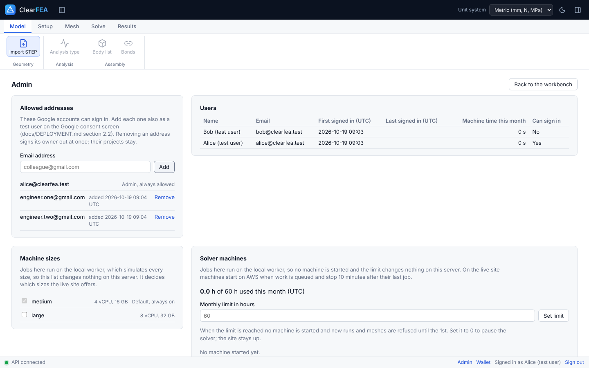

# Running the closed beta: admin guide

How the admin runs ClearFEA's closed beta at <https://clearfea.triyalabs.com> day to day: inviting and removing engineers, what they are given, machine sizes, what it all costs, and the tutorial trial that counts as gate item M9.8 (ADR-095). The one-time setup of Cloudflare, Google and AWS is in [DEPLOYMENT.md](DEPLOYMENT.md); the guide for the invited engineers is [USER_GUIDE.md](USER_GUIDE.md).

The admin is the Google account named by the `ADMIN_EMAIL` variable (DEPLOYMENT.md section 2.3). It is always allowed in, and it is the only account that sees **Admin** in the status bar along the bottom of the workbench. Choose it to open the admin page; **Back to the workbench** closes it.

## Contents

1. [Invite an engineer](#1-invite-an-engineer)
2. [Remove someone](#2-remove-someone)
3. [Who uses it](#3-who-uses-it)
4. [Credits](#4-credits)
5. [Machine sizes](#5-machine-sizes)
6. [What it costs](#6-what-it-costs)
7. [The tutorial trial (M9.8)](#7-the-tutorial-trial-m98)
8. [When an engineer is stuck](#8-when-an-engineer-is-stuck)

## 1. Invite an engineer

An invitation takes three steps, all needed. Ask for the exact Gmail address they will sign in with; many people have a second Google account (a work one, say) that would be refused.

1. **ClearFEA:** admin page → **Allowed addresses** → type the address → **Add**. It is listed in lower case with the time it was added.
2. **Google:** <https://console.cloud.google.com> → project `ClearFEA` → **Google Auth Platform** (or **APIs & Services** → **OAuth consent screen**) → **Audience** → **Test users** → **Add users** → the same address → **Save**. While the Google client is in Testing, Google itself refuses anyone not on this list, before ClearFEA sees them (DEPLOYMENT.md section 2.2). Google allows up to 100 test users.
3. **The invitation:** send them the message below. They need nothing else: no install, no password.

> Hi! You're invited to try ClearFEA, the finite element analysis tool I'm building, in a closed beta. It runs in the browser, so there is nothing to install.
>
> 1. Open https://clearfea.triyalabs.com on a laptop or desktop and choose Sign in with Google, with this Google account: ADDRESS
> 2. Follow the tutorial in the user guide (about 20 minutes, a plate with a hole): https://github.com/shubhs650/ClearFEA/blob/main/docs/USER_GUIDE.md. The model file is linked in its first section.
> 3. The first job after a break waits 1 to 3 minutes while a solver machine starts. That is normal.
>
> When something is unclear or breaks, send me a screenshot and a line on what you were doing (the guide's last section says how). Credits on the site are play money; it costs you nothing.

Replace ADDRESS with the address you added. The landing page links the user guide too ("Read the user guide", and "User guide" at the foot of the page).

An address is compared exactly after lower-casing, so `first.last@gmail.com` and `firstlast@gmail.com` are two addresses to ClearFEA even though Gmail treats them as one (ADR-097). Add the one they actually type.

## 2. Remove someone

Admin page → **Allowed addresses** → **Remove** next to the address. They are signed out at once and cannot sign in again. Their projects, runs and files stay. Adding the address again lets them back in to the same account, with the same projects and wallet.

You can also remove them from Google's test users, but ClearFEA's list alone is enough.

## 3. Who uses it

The **Users** table lists everyone who has signed in at least once: name and email from Google, first and last sign-in (UTC), the machine time their jobs used this month, and whether they can still sign in. An invited engineer appears here only after their first sign-in, so an address on the allowed list that has no user row has not tried yet.

The test users `alice` and `bob` appear only on a local `make dev` server; the live site has no password sign-in.

## 4. Credits

Each account gets 100 credits of play money at its first sign-in, the M8 placeholder grant (ADR-080). The standard machine costs 1 credit per machine hour and the large one 2, billed per started second of meshing and solving only; importing, reusing a mesh and anything that fails through a fault of ClearFEA are free. The tutorial costs a small fraction of a credit, so 100 credits is many hours of solving.

Credits are not money and are not linked to the AWS bill: they show the engineers what a job would cost and stop a runaway account. What you pay is machine hours (section 6), which the monthly limit caps.

There is no button to give an account more credits yet. If someone runs out, ask a thread in the Claude project to add a grant to their wallet; it is one row in the ledger.

## 5. Machine sizes

| Size | Shown as | Machine | Element limits | Cost to you on AWS |
| --- | --- | --- | --- | --- |
| Standard | `medium` | 4 vCPU, 16 GB | ADR-063 (PaStiX 142,000 10-node or 1,103,000 4-node elements) | about $0.23 per hour |
| Large | `large` | 8 vCPU, 32 GB | the same, until the large machine is benchmarked (ADR-095 item 5) | about $0.46 per hour |

Standard is always on. To switch on large, do both steps in this order:

1. AWS → **CloudFormation** → `clearfea` → **Update** → **Use existing template** → `LargeSizeEnabled` = `true` → **Next** to the end → **Submit** (DEPLOYMENT.md section 7.3).
2. Admin page → **Machine sizes** → tick **large**.

Runs then offer large next to standard. Until it is benchmarked it allows no bigger model, only a faster machine, so leave it off unless an engineer needs it. To switch it off, untick it: queued jobs for it fail without charge if no large machine is running, and a running one finishes its work.

## 6. What it costs

| What | Cost | Notes |
| --- | --- | --- |
| Cloudflare Workers Paid | $5 a month | Fixed. The site, API, database and the first 10 GB of files. |
| AWS solver machines | about $0.23 per standard machine hour | Only while a machine runs: from its start (including the 1 to 3 minutes it takes to start) to 10 minutes after its last job. |
| AWS image store | about $2 a month | The last ten solver images. |
| Google sign-in, GitHub | Free | |

A typical session of one engineer starts one machine, keeps it while they work and for 10 minutes after, so an hour of work costs about $0.25 to $0.30. With two or three engineers trying it now and then, expect $5 to $15 a month on AWS.

Three things keep the bill bounded:

- **The monthly limit.** Admin page → **Solver machines** shows the machine hours used this month (UTC) against the limit, 60 hours by default (about $14 on standard). When it is reached, no machine starts and new runs and meshes are refused until the 1st. Change it under **Monthly limit in hours**; 0 pauses the solver while the site stays up (ADR-100 item 7). A large-machine hour counts as one hour here, though it costs twice as much.
- **The budget email.** AWS emails `AlertEmail` when the month is forecast to pass 80% of `MonthlyBudgetUsd` and when it passes it (DEPLOYMENT.md section 4.3).
- **Nothing runs when nobody works.** The same card lists the latest machine starts and how each went. With no one working, nothing should be starting or running; DEPLOYMENT.md section 7.5 shows how to check in AWS.

The bills themselves are in AWS → **Billing and Cost Management** and Cloudflare → **Manage account** → **Billing** (DEPLOYMENT.md section 7.4).

## 7. The tutorial trial (M9.8)

Gate item 8 is met when two or three engineers complete the tutorial case unaided (ADR-095 item 12). The invited engineers do it on the live site.

1. Invite them (section 1) and agree a time, or let them do it when they have a free moment.
2. Watch over a screen share if you can, without helping unless they are stuck for more than a few minutes; each time you help is a finding. If they do it alone, ask them to note where they hesitated.
3. They have completed it when they have the von Mises result and the report. Their numbers should match the guide: largest von Mises stress about 183 MPa at the side of the hole, a reaction of 30,000 N and a smallest safety factor of 1.35.
4. Note for each engineer:

   | Note | Example |
   | --- | --- |
   | Who, and the date | Engineer A, 2026-10-22 |
   | Time from opening the invitation to the report | 35 min, of which 2 min waiting for the first machine |
   | Completed unaided? | Yes / with help at step … |
   | Where they hesitated or got stuck, in their words | "Could not find the far end face" |
   | Anything that broke | Screenshot, run link |
   | Largest von Mises stress they got | 183 MPa |

5. Paste the notes in the project chat. A thread records the outcome under M9.8 in `docs/PROGRESS.md` and proposes fixes for the top problems, which is the rest of M9.8.

## 8. When an engineer is stuck

| They say | What to do |
| --- | --- |
| "This Google account is not invited" | The address they picked on Google's screen is not on the allowed list. Ask which address it was; add that one (section 1) or have them pick the invited one. |
| "Access blocked: ClearFEA has not completed the Google verification process" | The address is not a test user on Google's side: section 1, step 2. |
| Google warns that it has not verified the app | Normal while the Google client is in Testing: they choose **Continue**. |
| The import or run waits a few minutes on "Starting a solver machine" | A machine is starting (1 to 3 minutes). If it waits more than about 7 minutes, look at **Solver machines** on the admin page: each start shows AWS's answer. |
| A job failed saying no solver machine came up | Three starts failed; the admin page lists why. DEPLOYMENT.md section 8 has the causes. |
| Runs are refused for machine hours | The monthly limit was reached: raise it (section 6). |
| Runs are refused for their balance | Their credits ran out: section 4. |
| "Google sign-in could not start: the server answered HTTP 403 (Internet Security by Zscaler …)" (or another company filter's name) | Their company's web filter blocks the site, not ClearFEA. Ask their IT to allow `clearfea.triyalabs.com`; meanwhile they can sign in from a phone on mobile data or a home network. |

For anything about deploys, keys or the AWS stack, see DEPLOYMENT.md section 8.
