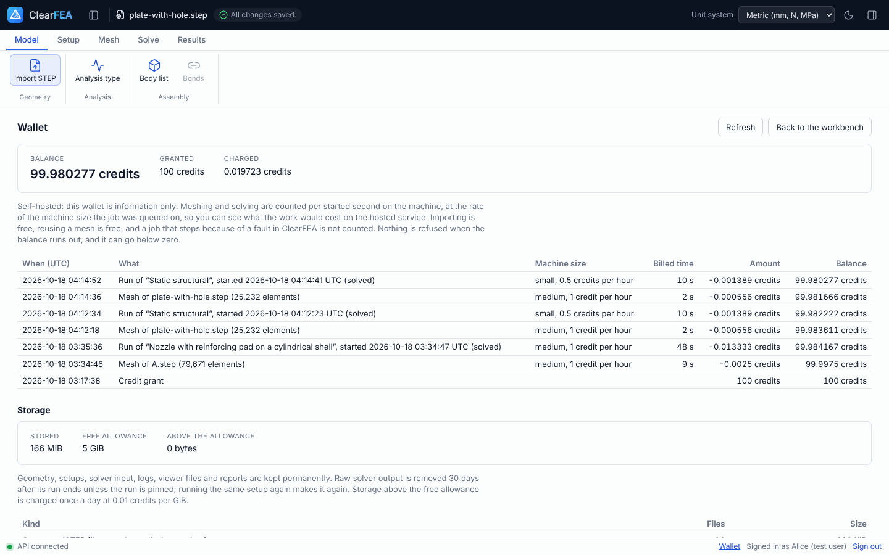

# Self-hosting ClearFEA

ClearFEA runs on your own machine with the same one command the project uses for development. Self-hosting is free and supported by the community only (GitHub issues and pull requests); there is no paid support. This page covers what the machine needs, how to install and start it, the self-hosting mode, model size limits, where your data lives, and what to do when something goes wrong. How to use the app once it runs is in the [user guide](USER_GUIDE.md).

**Status: Phase 0 prototype.** Everything below runs on localhost for one person at a time. There is no real authentication yet (see [Security](#security)), so do not open it to a network.

## What was checked where

| Platform | Status |
| --- | --- |
| Linux with Docker Engine (Ubuntu 24.04, x86-64) | Checked: the project is developed and tested this way, and every milestone's verification and browser tests pass on it. |
| Windows 10/11 with Docker Desktop and WSL 2 | Not yet checked. The steps below are what should work; the run on the project's verification laptop (an i5 10th-generation class machine with 16 GB, PLAN task M9.2) has not happened yet. |
| macOS with Docker Desktop | Not checked. The worker image is built for x86-64; on Apple silicon it would run under emulation, slowly if at all. |

Where a step below is marked *not checked*, it has not been run by the project. Please report what you find.

## What the machine needs

- **Memory: 16 GB.** The model size limits are set for a 16 GB machine (see [Model size](#model-size-limits)). An 8 GB machine starts and solves small models, but a large mesh can be stopped for lack of memory.
- **Processor:** any x86-64 processor from the last ten years. The solver uses one core per run; the worker container is allowed two.
- **Disk:** about 10 GB free: the worker image is about 2.1 GB, the build needs room for its layers, and Node and Python dependencies take about 1 GB. Results take more as you run models: a run of a 100,000-element mesh stores tens to hundreds of megabytes.
- **Software:**
  - [Docker](https://docs.docker.com/get-docker/), with the daemon running: Docker Engine on Linux, Docker Desktop on Windows.
  - [Node.js](https://nodejs.org/) 22 or newer, with [pnpm](https://pnpm.io/installation) (the version is pinned in `package.json`; `corepack enable` picks it).
  - [uv](https://docs.astral.sh/uv/getting-started/installation/), which installs Python 3.12 for the helper scripts by itself.
  - `git`, `make`, `bash` and `curl`.
- **Network:** only for the first install and the first build of the worker image, which downloads Ubuntu packages, Python packages and the solver sources. After that everything runs offline.

## Install and start

```
git clone https://github.com/shubhs650/ClearFEA.git
cd ClearFEA
make install
make dev
```

`make install` installs the TypeScript and Python dependencies from the lockfiles. `make dev` starts three things in one terminal and stops all three on Ctrl-C:

| Part | Where | What it does |
| --- | --- | --- |
| API | http://localhost:8787 | The Cloudflare Worker API under `wrangler dev`, with its database and file store kept on disk |
| Web app | http://localhost:5173 | The browser app (Vite), which forwards `/api` to the API |
| Worker | Docker container `clearfea-worker` | Imports STEP files, meshes with Gmsh, solves with CalculiX and writes reports |

The first `make dev` builds the worker image, including CalculiX with the PaStiX solver from pinned sources. That takes a while: about 8 minutes on the project's 4-core development machine with a fast connection, longer on a laptop. Later starts reuse the image and are ready in under a minute. When everything answers, the terminal prints:

```
[dev] Ready: open http://localhost:5173 (API on http://localhost:8787).
```

Open http://localhost:5173/app and sign in as `alice` with password `alice-local` (a second account, `bob` / `bob-local`, is there to check that users cannot see each other's work). Each account starts with 100 play-money credits.

To stop, press Ctrl-C in the terminal. Your projects, runs and files stay on disk for the next `make dev`.

### Linux

Install Docker Engine from Docker's own instructions for your distribution and start it (`sudo systemctl start docker`). Add yourself to the `docker` group, or `make dev` cannot reach the daemon without `sudo`. On Linux the worker container shares the host's network so that it can reach the API on 127.0.0.1 (ADR-016); nothing is opened to other machines.

The helper scripts that write the tutorial model and the test models use Gmsh on the host, which needs the system's OpenGL libraries even without a screen. On Ubuntu: `sudo apt-get install libglu1-mesa libxcursor1 libxinerama1 libxft2`.

### Windows (not checked)

1. Install [Docker Desktop](https://docs.docker.com/desktop/setup/install/windows-install/) with the WSL 2 back end, and a Linux distribution in WSL (Ubuntu 24.04).
2. In Docker Desktop, under Settings, Resources, WSL integration, turn on your distribution.
3. Give WSL enough memory. By default WSL 2 may use half of the machine's memory, so on a 16 GB laptop the solver gets about 8 GB. To give it more, create `%UserProfile%\.wslconfig` with:

   ```
   [wsl2]
   memory=13GB
   ```

   and run `wsl --shutdown` from PowerShell before starting again. Leave a few gigabytes for Windows and the browser.
4. Open the Ubuntu terminal and do everything from there: install Node, pnpm, uv, git and make inside WSL, clone the repository into the WSL file system (for example `~/ClearFEA`, not `/mnt/c/...`, which is much slower), then `make install` and `make dev`.
5. Open http://localhost:5173/app in your Windows browser.

`make dev` sees that Docker Desktop is in use and lets the worker reach the API through `host.docker.internal`.

### Behind a company proxy

If your network inspects HTTPS traffic with its own certificate authority, the worker image build cannot download packages until it trusts that certificate. Pass the CA bundle as a file:

```
make dev BUILD_CA=/path/to/company-ca-bundle.crt
```

The certificate is handed to the build as a BuildKit secret and never copied into the image (ADR-012).

## Self-hosting mode

On your own machine the play-money wallet should not get in your way. Turn on self-hosting mode (ADR-084) by adding one line to `apps/api/.dev.vars`, which `make dev` creates on its first start:

```
SELF_HOSTED=true
```

and restart `make dev`. In this mode:

- No run or mesh is refused because the balance is too low; the balance may go below zero.
- Every mesh and run is still metered and listed in the wallet, so you can see what each one would cost on the hosted service. The wallet page says that it is information only.
- Everything else is unchanged: element limits, the stop limit on each run, storage accounting and the free checks before a run.



Without the line (the default) the app behaves as the hosted service will: a run whose estimate is more than the balance is refused before it starts.

`apps/api/.dev.vars` also holds the worker token and the secret that signs sign-in cookies. Both start with example values; for a machine you share with others, change `SESSION_SECRET` to a long random string (this signs everyone out) and change `WORKER_TOKEN` (`make dev` passes it to the worker for you).

## Model size limits

Each equation solver has a largest mesh it may solve, measured on a 16 GB machine so that a run cannot run out of memory there (ADR-063). A run above its solver's limit is refused before it starts, with a message that says what to change. The limits are the same whatever machine you run on:

| Solver | 10-node elements (default) | 4-node elements |
| --- | --- | --- |
| PaStiX (default; static, thermal and thermal stress) | 142,000 | 1,103,000 |
| SPOOLES | 161,000 | 461,000 |
| Iterative Cholesky | 461,000 | 461,000 |
| Iterative scaling | 461,000 | 461,000 |
| SPOOLES, modal analysis (the only solver for modal) | 136,000 | 461,000 |

The iterative solvers take the largest meshes and need the least memory, but they stop at a fixed tolerance and were up to about 0.5 percent off on the verification cases, where PaStiX and SPOOLES are within 0.1 percent; the app says so wherever one is picked. The figures come from `packages/spec/estimator.json`, which the app reads, so they change only with a new benchmark.

The machine sizes in the Run panel (small 8 GiB, medium 16 GiB, large 32 GiB, xlarge 64 GiB) are simulated on your machine (ADR-082): the worker holds the solver to the size's cores and stops it past 85 percent of the size's memory. A size larger than your machine is not really larger: your machine's memory is the ceiling, and a run that goes past it is stopped and reported as out of memory. On a 16 GB machine, use the size the app recommends (small or medium) and a mesh within the limits above.

How long a run takes depends on the mesh. As a guide from the benchmark on the development machine: PaStiX solves a 97,000-element second-order mesh in about 3 minutes and needs about 7 GB; the estimate in the Run panel gives the expected time and peak memory for your mesh before you run.

## Where your data lives

| What | Where |
| --- | --- |
| Database (users, projects, simulations, runs, wallet) and files (STEP files, meshes, solver input and output, results, reports) | `apps/api/.wrangler/state/`, the local D1 database and R2 store of `wrangler dev` |
| Settings and secrets | `apps/api/.dev.vars` |
| Storage settings (free allowance, raw-output retention, storage rate) | rows of the `settings` table in the database |

Back up by stopping `make dev` and copying `apps/api/.wrangler/state/` (and `.dev.vars`). Restore by putting the copy back. To start again with nothing, stop `make dev` and delete `apps/api/.wrangler/state/`; the next `make dev` creates an empty database and the two test users.

Raw solver output (`.frd`, `.dat`) of a run that is not pinned is removed 30 days after the run; everything you need to look at and report a run is kept. `make dev` runs this clean-up at start and every hour (ADR-086). To keep raw output longer, pin the run in its Run panel, or change the retention:

```
pnpm --filter @clearfea/api exec wrangler d1 execute DB --local \
  --command "UPDATE settings SET value = 365 WHERE name = 'raw_output_retention_days'"
```

## Updating

```
git pull
make install
make dev
```

`make dev` applies new database migrations at start and rebuilds the worker image when its sources changed. Runs you made before keep their frozen setup, mesh, solver input, versions and cost; a new version of the solver or mesher shows up in new runs' records only.

## Security

Phase 0 has no real authentication. The two accounts and their passwords are published in this repository, and `make dev` resets them on every start. The API and web app listen on localhost only, and the worker reaches the API with a shared token. So:

- Use it on your own machine. Do not forward its ports or put it behind a public address.
- Anyone who can use your computer's account can open your work.

Real accounts come with the hosted beta (Phase 1).

## Licence

ClearFEA is under the GNU Affero General Public License v3.0 or later. You may run, change and share it. If you change it and let other people use your changed version over a network, the AGPL asks you to offer them its source. CalculiX, Gmsh and OpenCASCADE, which the worker image includes, come with their own licences.

## When something goes wrong

| What you see | What to do |
| --- | --- |
| `Dependencies are not installed. Run 'make install' first.` | Run `make install`. |
| `Cannot reach the Docker daemon.` | Start Docker Desktop, or on Linux the Docker service, then `make dev` again. |
| `Port 8787 is already in use` (or 5173) | An earlier `make dev` is still running. Stop it with Ctrl-C in its terminal, or end the process using the port. |
| The worker image build fails while downloading, with a certificate error | You are behind a proxy that inspects HTTPS. See [Behind a company proxy](#behind-a-company-proxy). |
| `toomanyrequests` from Docker while building | The build pulls its base image through `mirror.gcr.io`, which needs no account; try again later, or sign in to Docker Hub with `docker login`. |
| An upload stays at "Importing" | The worker is not running or cannot reach the API. Look for `[worker]` lines in the `make dev` terminal. |
| A run fails as out of memory | The mesh needed more memory than the machine size, or than your machine has. Use a coarser mesh, 4-node elements, or the recommended size; on Windows, give WSL more memory. |
| A run is refused before it starts | The Run panel lists why, in plain words: something missing in the setup, a mesh over the solver's limit, or (outside self-hosting mode) a balance too low for the estimate. |

The `make dev` terminal prefixes every line with `[api]`, `[web]` or `[worker]`, which is the first place to look. When you report a problem, include those lines, and for a failed run its solver log, which the Run panel lets you download.
