# ClearFEA user guide

This guide walks through the main flow of ClearFEA with one small model: a steel plate with a hole, pulled at one end. It takes about twenty minutes and covers every step you need for your own parts: upload a STEP file, set up the analysis, mesh, run, read the results and make a report. The last part says how the other analysis types and assemblies differ.

ClearFEA runs at **<https://clearfea.triyalabs.com>**, in a closed beta for invited engineers. There is nothing to install: you need a laptop or desktop with a current Chrome, Edge, Firefox or Safari, a mouse or trackpad, and the Google account you were invited with. The landing page reads well on a phone, but the workbench is made for a larger screen and a mouse.

ClearFEA can also run on your own computer; for that, see [Self-hosting ClearFEA](SELF_HOSTING.md), and sign in as section 2 says at the end. For what ClearFEA will and will not do, see [docs/DECISIONS.md](DECISIONS.md).

ClearFEA is an analysis tool. It gives numbers for the model you set up and never says whether a design is acceptable; that judgement stays with the engineer.

## Contents

1. [The tutorial model](#1-the-tutorial-model)
2. [Sign in and upload the geometry](#2-sign-in-and-upload-the-geometry)
3. [The workbench](#3-the-workbench)
4. [Analysis type and material](#4-analysis-type-and-material)
5. [Loads and supports](#5-loads-and-supports)
6. [Mesh](#6-mesh)
7. [Run](#7-run)
8. [Results](#8-results)
9. [Report](#9-report)
10. [Share, wallet and storage](#10-share-wallet-and-storage)
11. [Other analyses and assemblies](#11-other-analyses-and-assemblies)
12. [Units](#12-units)
13. [When something does not work](#13-when-something-does-not-work)
14. [Feedback during the closed beta](#14-feedback-during-the-closed-beta)

## 1. The tutorial model

A plate 300 mm long, 100 mm wide and 5 mm thick, with a 10 mm hole through its centre. One end is held fixed and the other is pulled along the plate with 30 kN.

**Get the model.** Download **[plate-with-hole.step](https://clearfea.triyalabs.com/tutorial/plate-with-hole.step)** (19 KB) and save it where you will find it, for example in Downloads. You can also draw the plate in your own CAD program from the sizes above, with the plate's corner at the origin, and save it as STEP.

Developers can write the same file with the script it comes from, `docs/tutorial/plate_with_hole.py`, from the repository root after `make install`: `uv run --project worker python docs/tutorial/plate_with_hole.py plate-with-hole.step`. A self-hosted ClearFEA serves the file at `/tutorial/plate-with-hole.step` too, for example <http://localhost:5173/tutorial/plate-with-hole.step>.

**What to expect.** Away from the hole the stress is the force over the cross-section: 30,000 N / (100 mm × 5 mm) = 60 MPa. At the sides of the hole it is about three times that: for a hole of a tenth of the plate's width the stress concentration factor on the gross section is 3.03 (Howland; Peterson's chart gives 3.02), so about 182 MPa. With a Poisson's ratio of 0.3 the peak at mid-thickness is a little higher than this plane-stress value. Verification case V-03 checks the same plate to 1 percent.

## 2. Sign in and upload the geometry

Open <https://clearfea.triyalabs.com> and choose **Sign in with Google**, then **Sign in with Google** again on the sign-in card. Google asks which account to use: pick the one you were invited with. The first time, Google says that ClearFEA will see your name and email address, which is all it reads; it may also warn that Google has not verified the app, because ClearFEA is registered with Google in testing for the beta. Choose **Continue**. You then land in the workbench, already signed in the next time you open the site.

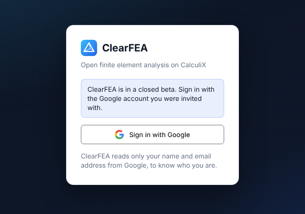

If ClearFEA says "This Google account is not invited", you picked another Google account than the one on the invitation (a work account, say). Choose **Sign in with Google** again and pick the invited one, or ask the person who invited you to add the address you use. If Google itself says "Access blocked: ClearFEA has not completed the Google verification process", that address has not been added on Google's side yet; ask the person who invited you.

On a company network, the company's web filter (Zscaler, for example) can block the sign-in: the card then says "Google sign-in could not start: the server answered HTTP 403", usually with the filter's name. ClearFEA is fine; the filter stopped the request before it arrived. Ask your IT to allow `clearfea.triyalabs.com`, or sign in from a home network or a phone on mobile data.

On a self-hosted ClearFEA, open <http://localhost:5173/app> instead and sign in as `alice`, password `alice-local`.

Each account starts with 100 credits of play money, which is enough for many hours of solving; see [Wallet](#10-share-wallet-and-storage).

Under **Geometry** on the right, choose **Upload a STEP file** and pick `plate-with-hole.step`. The file is imported on the server; the model then appears in the viewer.

**The first job takes a minute or two longer.** On the live site, the import, meshing, solving and report jobs run on a solver machine that is started only when there is work and stops ten minutes after its last job, so nobody pays for an idle machine. The first job you start after a break waits 1 to 3 minutes while a machine starts, and the panel says **Starting a solver machine** meanwhile. Leave the page open, or come back later: nothing is lost. Jobs after that start at once while you keep working, so the import takes a few seconds and the tutorial run about 20 seconds.

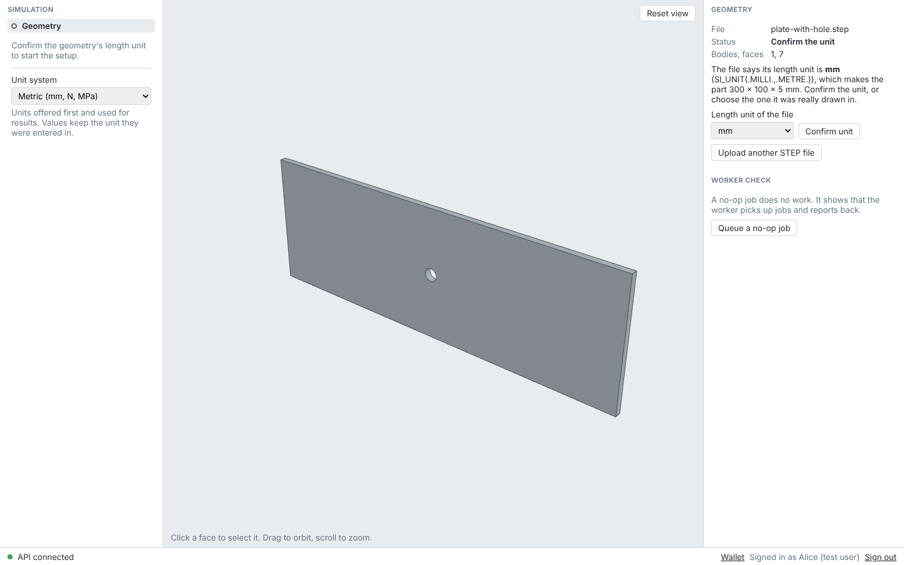

ClearFEA reads the length unit from the STEP file and shows the size it gives: here mm, so 300 × 100 × 5 mm. Check that the size is right. If the part was drawn in another unit than the file says, choose that unit before going on; the file is then imported again in it. Choose **Confirm unit**.

Only STEP files (`.step`, `.stp`) with solid bodies are taken. Surfaces, shells and wire geometry are not.

## 3. The workbench

Choose **Start setup**. Across the top are the header (the file, whether it is saved, the unit system and a light or dark theme) and the **ribbon**, whose tabs Model, Setup, Mesh, Solve and Results hold the main commands: a click on **Fixed** or **Pressure** under Setup, for example, adds that support or load on the faces selected in the viewer. The tab follows the item open in the tree. Below them are three columns:

- **Model tree** on the left: Geometry, Analysis, Bodies, Materials, Supports, Loads, Mesh, Run and Report. A green dot means the item is complete; an orange ring means something is missing. Hover over an item to see what.
- **Viewer** in the middle. Drag to orbit, right-drag to pan, scroll to zoom; press F to frame the model, choose **Reset view** for the isometric view, or click a face of the view cube at the top right to look from the front, top or a side. The tools under the cube pick a display **Style** (shaded, see-through or hidden lines), a **Cut plane**, which bodies are shown and saved **Views**. Hover over a face to see its number, type and area; click it to select it. Click again to unselect, or use **Clear** at the bottom.
- **Settings** on the right, for the item picked in the tree.

Every change is saved by itself a moment after you make it; "All changes saved." in the header says when it is. The **Unit system** in the header picks the units offered first and used for results (see [Units](#12-units)). The workbench shows your most recent upload; uploading another file starts a new setup for it.

## 4. Analysis type and material

**Analysis** is linear static by default. That is what the tutorial needs.

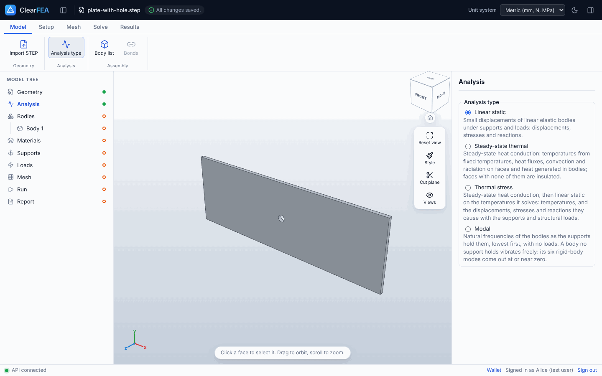

Open **Materials**. Under "From the library or your materials", pick **Carbon steel AISI 1025** and choose **Add this material**. The library holds 24 metals with their source (MIL-HDBK-5G) shown with each value. Check the values against your own material's data: they are generic, and the yield strength is the handbook's minimum for one product form.

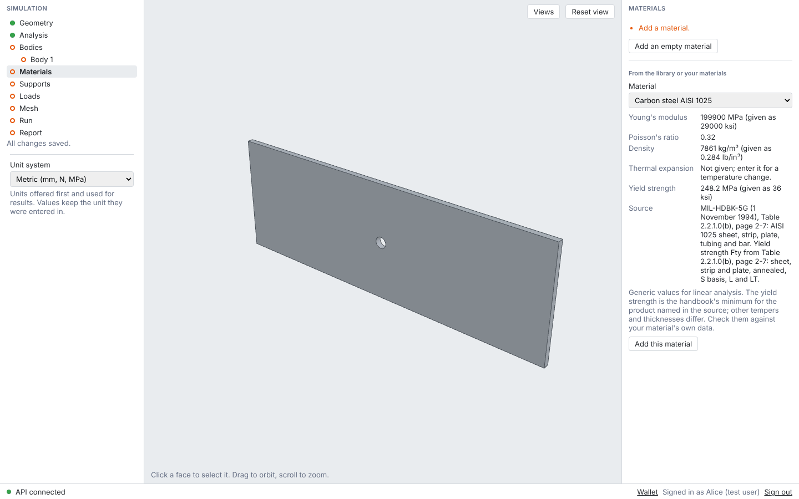

With one body, the material is given to it at once. With several bodies, each body gets its material under **Bodies**. To type in a material of your own, choose **Add an empty material**; Young's modulus and Poisson's ratio are required, density is needed for gravity and centrifugal loads, thermal expansion for temperature loads, and yield strength for the safety-factor plot. A material you add is kept in "Your materials" for later simulations.

## 5. Loads and supports

Supports and loads act on faces. Select the faces in the viewer first, then add the item: it takes the selected faces. You can change the faces later with **Use the selected face** and **Remove all faces**.

**The force.** Click the plate's end face at x = 300 mm, the narrow face nearest the viewer on the right in the starting view. The bottom of the viewer says "1 face selected". Open **Loads** and choose **Add a force**. Name it "Pull" and enter **x = 30 kN**, y = 0 and z = 0. The unit list next to each value lets you type it in any unit.

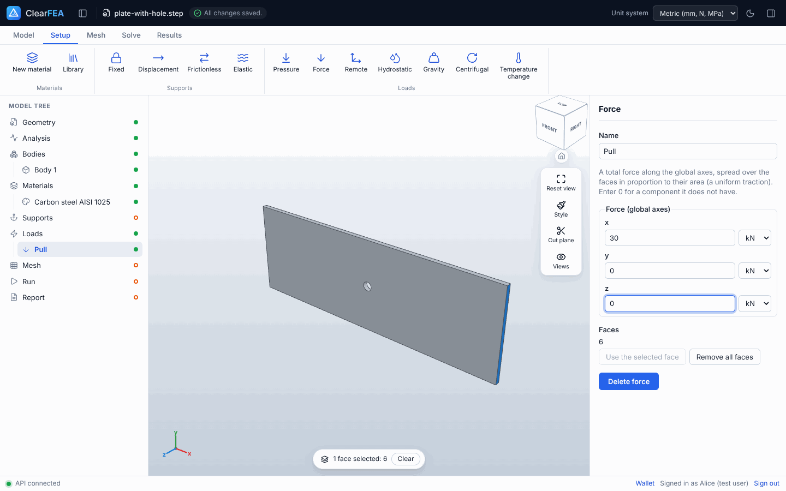

A force is a total, spread over its faces in proportion to their area. For a load per area use **Add a pressure** instead.

**The fixed support.** Choose **Clear**, then drag in the viewer to turn the plate round until you see the other end face, at x = 0, and click it. Open **Supports** and choose **Add a fixed support**. Choose **Reset view** afterwards.

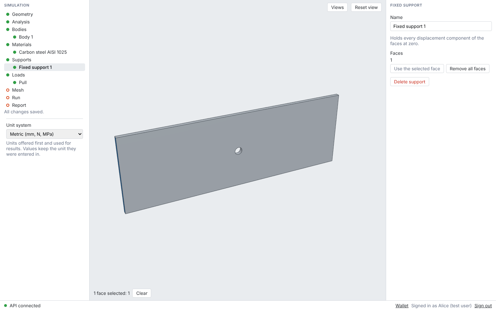

The other supports are prescribed displacement, frictionless (a symmetry plane) and elastic (springs normal to the face). The other structural loads are pressure, remote force and moment, hydrostatic pressure, gravity, centrifugal load and a uniform temperature change. Each panel says in one line what the item does.

Before a run, ClearFEA checks for free that every body has a material, that the model is held against rigid-body motion, and that every item has its faces and values. What is missing is listed at the top of the panel and in the Run panel.

## 6. Mesh

Open **Mesh**. The **Global size** is the largest element edge; enter **5 mm**. The **Element order** is second order (10-node tetrahedra) by default, which is what stresses need; first order is there for large models where stresses matter less.

The hole needs smaller elements to show its peak. Zoom in on the hole, click the hole's face to select it, and choose **Add a local size on faces**. Name it "Hole" and enter a **Size** of **0.5 mm**. Elements grow by about 20 percent per element from the local size to the global size.

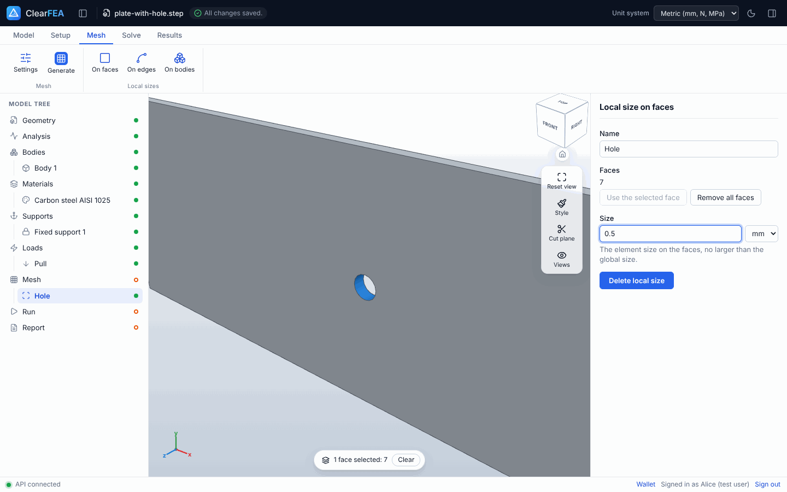

Choose **Generate mesh**. Meshing runs on the server and is charged like solving, at a fraction of a credit for this model. The viewer then shows the mesh, and the panel the element and node counts and a quality summary: the ratio of inscribed to circumscribed sphere radius per element (1 for a regular tetrahedron) and the smallest scaled Jacobian. A handful of elements below 0.2 is normal; many are a sign the mesh size is too large for a thin or small feature.

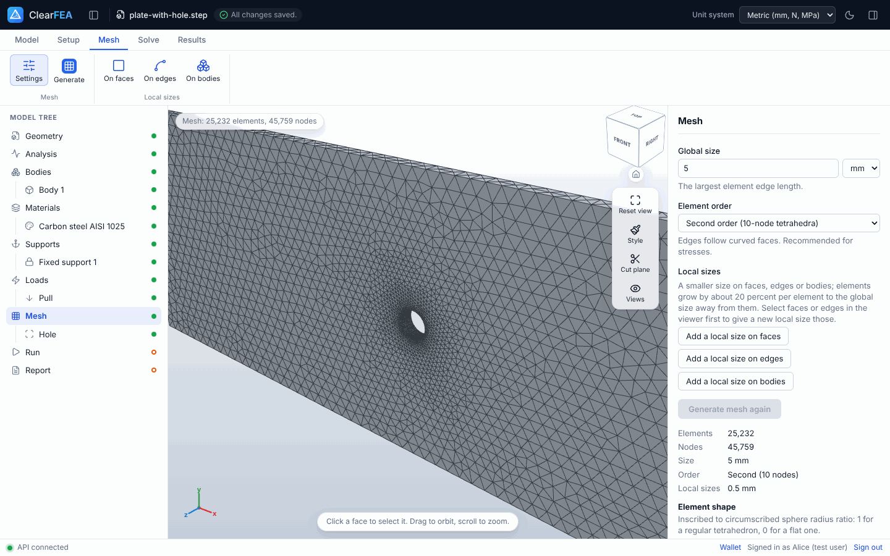

The tutorial mesh has about 25,000 elements and 46,000 nodes. A mesh is reused while its settings and the geometry stay the same, so running again does not mesh again.

## 7. Run

Open **Run**. Before anything is charged, the panel shows:

- **Equation solver.** PaStiX, the default, is the fastest. SPOOLES is the other direct solver. The two iterative solvers take larger meshes with less memory, but stop at a fixed tolerance and were up to about 0.5 percent off on the verification cases, against 0.1 percent for the direct ones. Each solver has an element limit (see [Self-hosting, model size limits](SELF_HOSTING.md#model-size-limits)); a mesh above it is refused before the run.
- **Estimate.** The solver's peak memory, the time and the cost, from a benchmark of the solver. The estimate is made for a stocky block; slender parts usually need less memory and time.
- **Machine size.** The recommended size is picked from the estimated memory. A smaller one is allowed, with a warning: if the run then runs out of memory, you pay for the time it used.
- **Stop limit.** A run still solving after three times the estimated time is stopped and charged for its time. Change the multiple (0.25 to 20) for a run you expect to be slow.

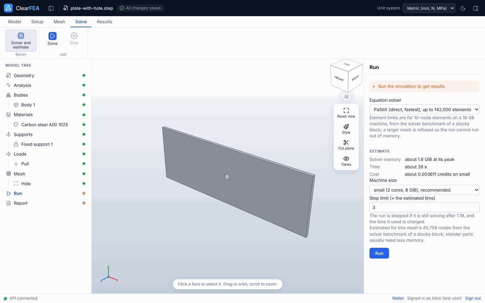

Choose **Run**. The panel shows the stage, the time so far against the estimate, the cost so far, and the solver's log as it is written. **Cancel the run** stops it; a cancelled run is charged the time it used. You can close the browser: the run carries on, and its results are there when you come back.

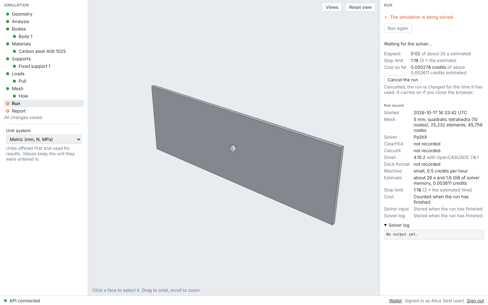

The tutorial solves in about 20 seconds, once a solver machine is running (see the first job's wait in [section 2](#2-sign-in-and-upload-the-geometry)).

## 8. Results

When the run has finished, the viewer shows the von Mises stress on the deformed shape, with a legend of nine bands and markers at the smallest and largest values. The panel on the right lists the largest displacement, the largest von Mises stress and where they are, and the smallest safety factor against yield.

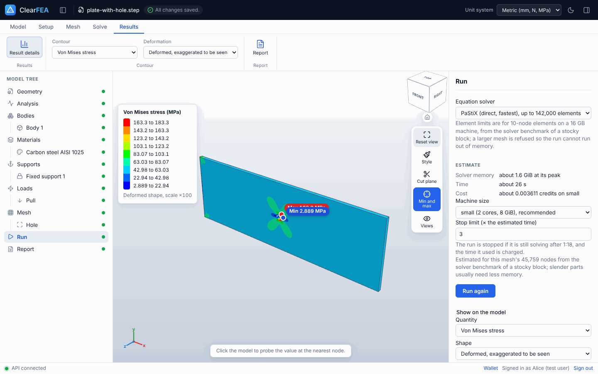

For the tutorial the largest von Mises stress is about 183 MPa at the side of the hole, 1 percent above the 182 MPa plane-stress hand value, as expected for mid-thickness with a Poisson's ratio of 0.3. Zoom in to see it. Click anywhere on the model to probe the value at the nearest node; the probes are listed at the bottom of the viewer and cleared with **Clear probes**.

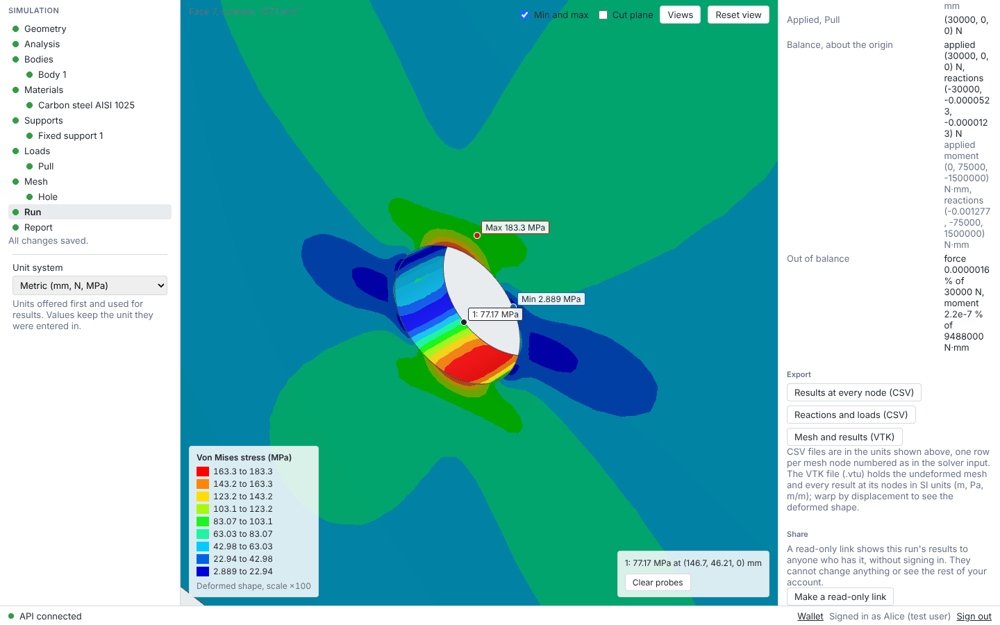

What you can change in the panel (the quantity and shape are also under the ribbon's Results tab, as **Contour** and **Deformation**):

- **Quantity:** displacement and its components, von Mises stress, principal stresses, stress and strain components, and the safety factor against yield. Thermal runs add temperature and heat flux.
- **Shape:** deformed (exaggerated so it can be seen, with the scale in the legend), true scale, or undeformed.
- **Units shown:** per kind of quantity, without running again.

**Reactions and balance.** Below the result summary, each support's reaction force and moment are listed, then the applied loads, then the balance: how far the reactions are from the applied loads, as a percentage of the load. For the tutorial the reaction is 30,000 N against the pull and the out-of-balance force is about 1e-6 percent. A large out-of-balance value means something in the model needs a look.

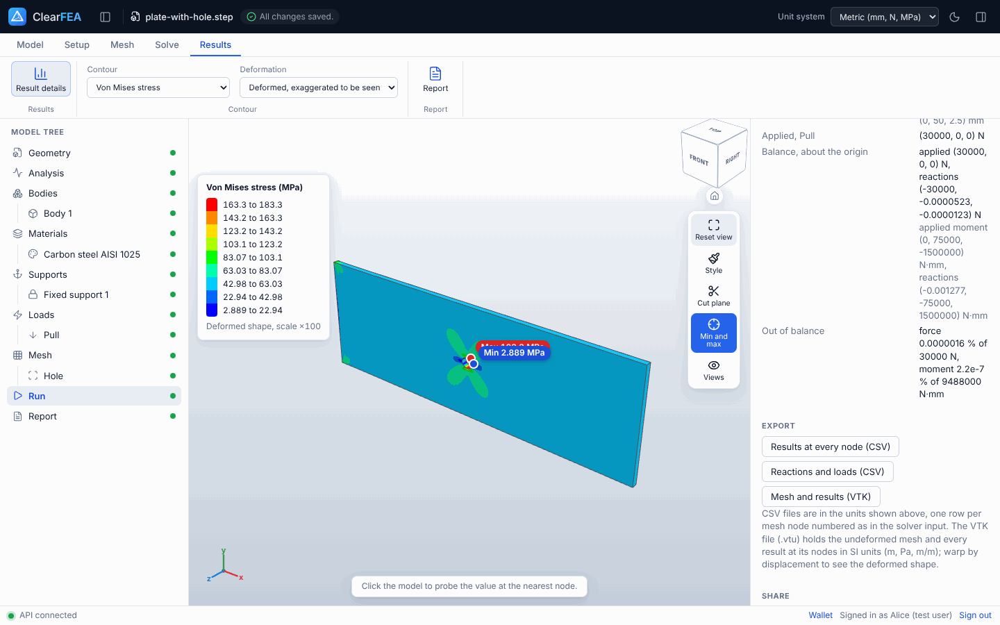

**Cut plane.** Choose **Cut plane** beside the viewer to cut the model across x, y or z and move the plane with the slider. On results the section shows the values inside the part; on the geometry or mesh the cut is filled in orange, and faces inside (a bore, say) can be picked through it.

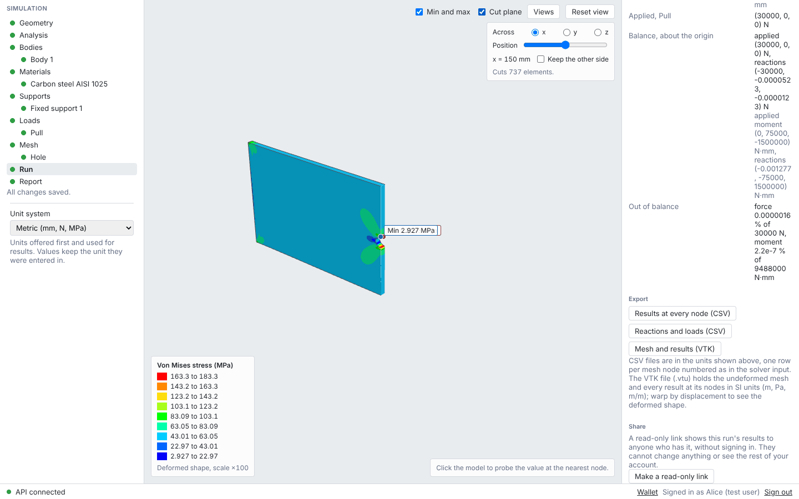

**Safety factor against yield** is the material's yield strength over the von Mises stress at each node, shown up to 15. For the tutorial the smallest is 1.35, at the hole. It is a number, not a verdict: whether it is enough is your decision.

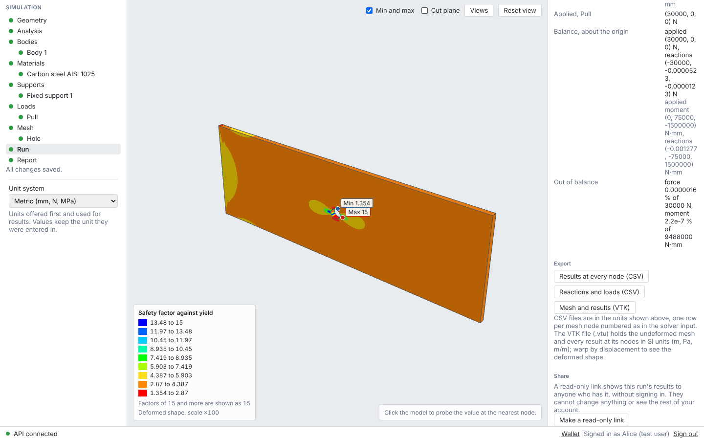

**Views.** Choose **Views** beside the viewer, name the current view and **Save view**. A saved view keeps the camera, the quantity, the shape, the cut plane and hidden bodies, and can be picked for the report. Here, save the whole-plate von Mises view as "Whole plate".

**Export.** "Results at every node (CSV)" and "Reactions and loads (CSV)" are in the units shown; "Mesh and results (VTK)" opens in ParaView with every field in SI units.

**Run record.** At the bottom of the panel each run keeps what produced it: start and finish, the mesh, the solver, the ClearFEA, CalculiX and Gmsh versions, the machine, the estimate, the stop limit and the cost. **View deck.inp** shows the exact CalculiX input that was solved and **View solver.log** its log; both can be downloaded, so the run can be repeated on any CalculiX 2.21. The input is generated from the setup and cannot be edited. A run never changes after it is made: change the setup and **Run again** to get a new one.

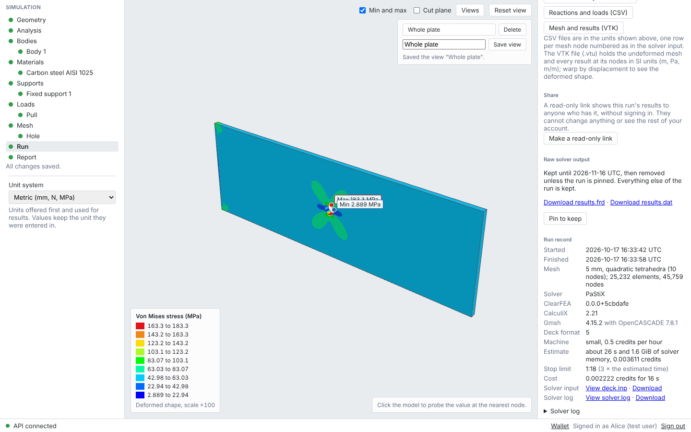

## 9. Report

Open **Report**. Fill in the report title, document number, revision and prepared-by, choose the sections to include, tick the saved views to add as figures (here "Whole plate"), and pick the report's unit system. Company name and logo (PNG or JPEG up to 1 MB) are kept for all your reports. Choose **Save report options**.

Choose **Make the report**. ClearFEA draws a figure of each support and load and each picked view, then makes a Word file and a PDF printed from it. Both appear as download links when they are ready.

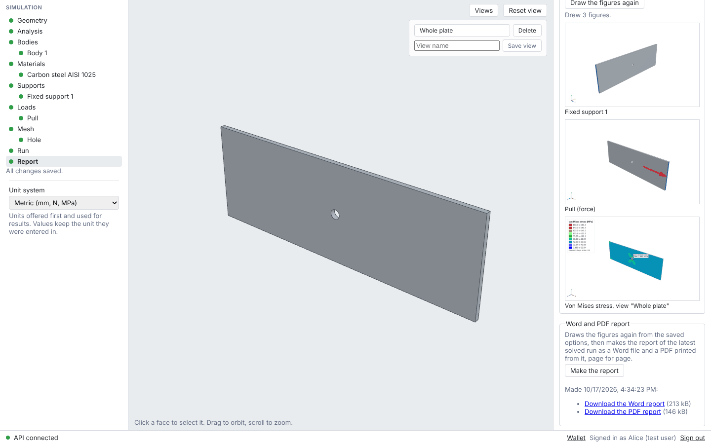

The report has twelve sections: about this report, project and revision, geometry and units, materials, mesh statistics, loads and supports with a figure each, solver settings and versions, result plots, the reaction and balance check, minimum and maximum tables, run warnings, and software and verification. It states the numbers only; it does not compare them with any code or standard.

## 10. Share, wallet and storage

**Share.** In the Run panel, **Make a read-only link** gives a link to this run's results that anyone can open without signing in. They see the model, the results and the run's record, and cannot change anything or see the rest of your work. The link is shown once, so copy it then. **Revoke the link** stops it working; making a new one replaces the old one.

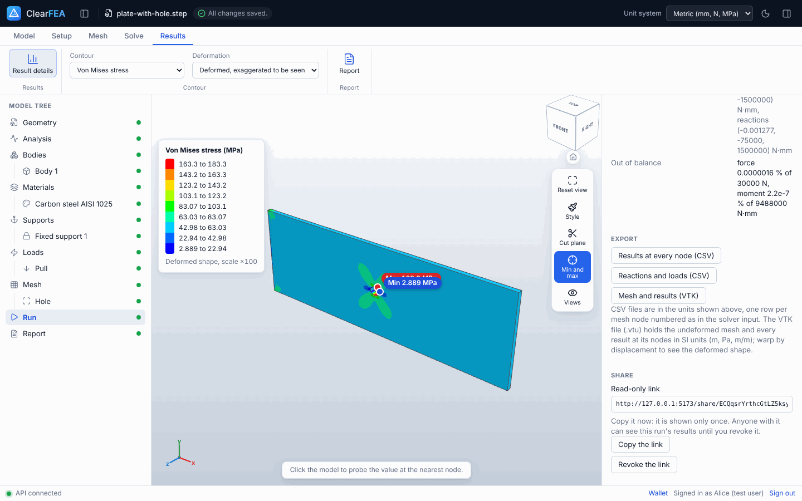

**Wallet.** **Wallet** at the bottom right opens your balance and every charge: each mesh and run with its machine size, billed seconds and amount. In Phase 0 the credits are play money (each account starts with 100) and the rates are placeholders. Meshing and solving are billed per started second at the rate of the machine size; importing and reusing a mesh are free; a job that fails through a fault in ClearFEA costs nothing. A failed run says whose fault it was and why. In self-hosting mode the wallet is information only and nothing is refused for its balance.

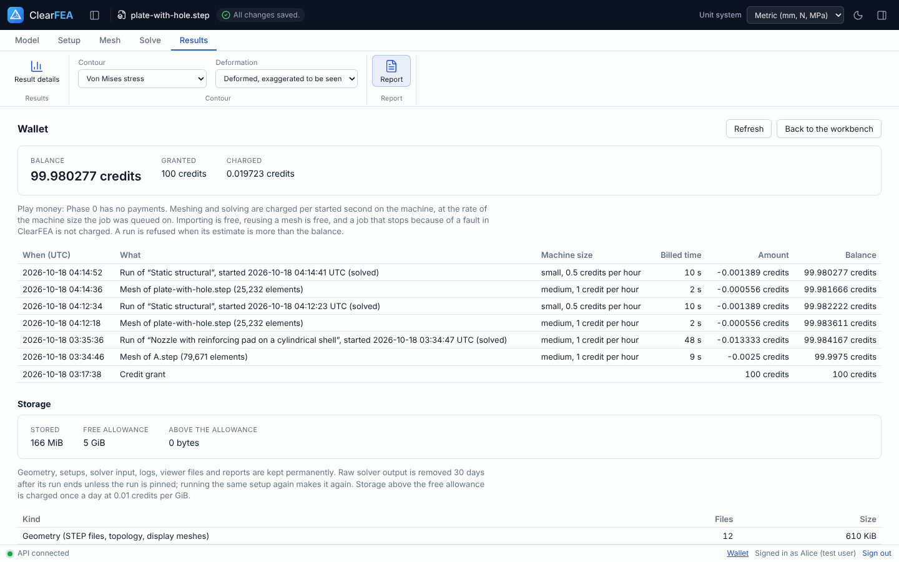

**Storage.** The wallet page also lists what your files take. Geometry, setups, solver input, logs, results for the viewer and reports are kept. The raw solver output (`.frd` and `.dat`, downloadable from the Run panel) is removed 30 days after the run unless you choose **Pin to keep**; running the same setup again makes it again. Storage above the free allowance of 5 GiB is charged once a day.

## 11. Other analyses and assemblies

The flow is the same for every analysis; what changes is the Analysis item and the loads offered.

**Assemblies.** A STEP file with several solid bodies is imported as an assembly. Bodies are listed under **Bodies** by their part names, each with one material. Touching faces of different bodies are found at import and tied together; review them under **Bonds**, where **Show the bond** selects its two faces and you can accept or remove each one. Every body must be held, by a support or through a bond to a held body, or the run is refused. Stresses within a few millimetres of a bonded face can be off by up to about 13 percent; the results say so.

**Steady-state thermal.** Pick it under **Analysis**. Loads are fixed temperature, heat flux, convection, radiation to the surroundings and heat generation; faces with none of these are insulated. Materials need thermal conductivity, which the library does not hold, so enter it in your own material. Results are temperature and heat flux, with each load's heat flow and the heat balance in place of reactions.

**Thermal stress.** Solves the thermal analysis and then a static one on the temperatures it found, in one run. Enter the stress-free temperature under **Analysis**; materials need conductivity and thermal expansion. Structural supports and loads apply as well as the thermal loads. Conductivity, Young's modulus, Poisson's ratio and expansion may each be a table against temperature.

**Modal.** Natural frequencies and mode shapes of the bodies as the supports hold them, with no loads. Enter the **Number of modes** (up to 100) under **Analysis**. Modal runs use SPOOLES. A body no support holds has six rigid-body modes at or near zero. Mode shapes are unitless (scaled to a largest displacement of 1) and can be animated.

The verification cases in [docs/VERIFICATION.md](VERIFICATION.md) show each load and support type at work on a model with a known answer.

## 12. Units

Every value has its own unit list, so you can enter a pressure in MPa next to a force in lbf; the value keeps the unit it was typed in. The **Unit system** in the header (metric with mm, SI with m, or US with inches) sets the units offered first for new values and the units results are shown in. In the results you can change the units of each kind of quantity under **Units shown** without running again. The report has its own unit system, chosen in the report options. Inside, everything is stored and solved in SI units.

## 13. When something does not work

| What you see | What to do |
| --- | --- |
| The file's unit is wrong, so the part is 1000 times too big or small | Choose the right unit before **Confirm unit**. After a simulation uses the geometry its unit is locked; upload the file again. |
| An item in the tree has an orange ring | Hover over it, or open it: the panel lists what it needs. |
| **Run** is greyed out | The Run panel lists why, for example a body without a material, a model that is not held, or a mesh that is older than the setup. Each line names the item to fix. |
| "The mesh has … elements, more than … can solve" | Make the mesh coarser, use 4-node elements, or pick a solver with a higher limit, as the message says. |
| The run failed | The run says why and whose fault it was. A model that is not held (a singular matrix), a mesh that fails on the geometry, or running out of memory on a size smaller than recommended is charged; a fault in ClearFEA is not. Open **View solver.log** for CalculiX's own messages. |
| The run was stopped at its stop limit | Raise the stop limit and run again, or make the mesh coarser. |
| A face is hard to click | Zoom in with the scroll wheel and orbit until the face looks towards you; the hover text says which face is under the pointer. |
| "This Google account is not invited" | Sign in again with the Google account you were invited with, or ask the person who invited you to add this one. |
| "Google sign-in could not start: the server answered HTTP 403" with a company filter's name (Zscaler, for example) | Your company's web filter blocks the site. Ask your IT to allow `clearfea.triyalabs.com`, or sign in from a home network or a phone on mobile data (section 2). |
| Google says "Access blocked: ClearFEA has not completed the Google verification process" | Your address is not yet on Google's list of test users for ClearFEA. Ask the person who invited you to add it. |
| "Starting a solver machine" | After a break a machine takes 1 to 3 minutes to start. Leave it; the job starts by itself, even if you close the page. |
| A job failed saying no solver machine came up, or that the site has used its machine hours for this month | Not your fault, and nothing is charged. Try again later, and tell the person who invited you. |

The live site is updated whenever a change is ready, often more than once a day during the beta. Reload the page now and then to get the newest version; a run that is going carries on unchanged.

## 14. Feedback during the closed beta

ClearFEA is being built from what you find, so every rough edge you report is useful, small ones included. Send it to the person who invited you, by whatever channel you usually use, with:

- **What you were doing**, and what you expected to happen.
- **What happened instead**, with a screenshot if you can (on Windows press Windows + Shift + S; on a Mac, Cmd + Shift + 4).
- **A link to the run**, if it is about one: in the Run panel choose **Make a read-only link** and paste it. Whoever opens it sees that run's model, results and record, nothing else of yours.

Also say where the guide or the screens left you unsure what to do next. Do not upload geometry you are not allowed to share: during the beta, the person running it can reach the files stored on it.
